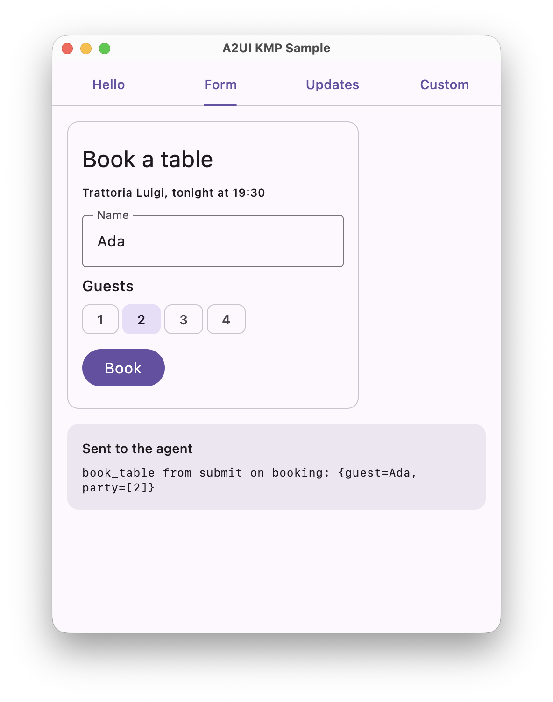
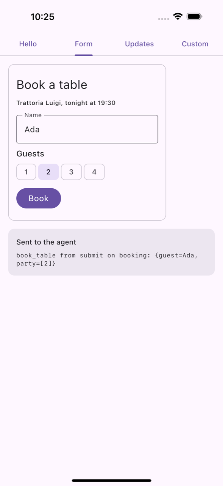

# a2ui-kmp

Google's [Agent-to-UI renderer for Jetpack Compose](https://developer.android.com/develop/ui/compose/agentic)
([A2UI](https://a2ui.org)) on Kotlin Multiplatform: the same library and API on Android, desktop (JVM)
and iOS. On Android you get Google's own artifacts; for desktop and iOS it is built from Google's
sources.

Sponsored by [LittlePress.AI](https://littlepress.ai). Not affiliated with Google.

> **Not on Maven Central yet.** The first release, `1.0.0-alpha02`, is being prepared. Until it is
> published, build the artifacts locally (see [DEVELOPMENT.md](DEVELOPMENT.md)).

## Versions

Versions match [Google's releases](https://developer.android.com/jetpack/androidx/releases/a2ui):
`1.0.0-alpha02` is built from Google's `1.0.0-alpha02` (see [source/UPSTREAM](source/UPSTREAM) and
[CHANGELOG.md](CHANGELOG.md)). We will keep following them until Google publishes A2UI for
Kotlin Multiplatform itself. The API is Google's, in the same `androidx.a2ui.*` packages; common
code differs from Android code in two places only (see [Platforms](#platforms)).

## Declaring dependencies

Add the artifacts to your version catalog, with the Google and Maven Central repositories:

```toml
# gradle/libs.versions.toml
[versions]
a2ui = "1.0.0-alpha02"

[libraries]
a2ui-material3-kmp = { module = "ai.littlepress.a2ui:material3-a2ui", version.ref = "a2ui" }
a2ui-compose-ui-kmp = { module = "ai.littlepress.a2ui:compose-ui", version.ref = "a2ui" }
a2ui-compose-runtime-kmp = { module = "ai.littlepress.a2ui:compose-runtime", version.ref = "a2ui" }
a2ui-model-kmp = { module = "ai.littlepress.a2ui:a2ui-model", version.ref = "a2ui" }
a2ui-engine-kmp = { module = "ai.littlepress.a2ui:a2ui-engine", version.ref = "a2ui" }
a2ui-compose-ui-testing-kmp = { module = "ai.littlepress.a2ui:compose-ui-testing", version.ref = "a2ui" }
```

```kotlin
// settings.gradle.kts
dependencyResolutionManagement {
    repositories {
        google()
        mavenCentral()
    }
}

// build.gradle.kts
kotlin {
    sourceSets.commonMain.dependencies {
        // 1. The basic catalog drawn with Material 3, and everything it needs
        implementation(libs.a2ui.material3.kmp)
        // 2. Or, to draw your own components: the renderer and catalog API without Material 3
        // implementation(libs.a2ui.compose.ui.kmp)

        // 3. Only the Compose runtime of the renderer (state, data binding), to build your own renderer
        // implementation(libs.a2ui.compose.runtime.kmp)
        // 4. Only the protocol model, without Compose
        // implementation(libs.a2ui.model.kmp)
        // 5. The engine that processes messages, for renderer developers (no Compose)
        // implementation(libs.a2ui.engine.kmp)
    }
    sourceSets.commonTest.dependencies {
        // 6. Testing APIs for your catalog's components
        // implementation(libs.a2ui.compose.ui.testing.kmp)
    }
}
```

All artifacts have the same version:

| Artifact `ai.littlepress.a2ui:` | | On Android |
| --- | --- | --- |
| `a2ui-model` | The A2UI core data layer for app and component developers | `androidx.a2ui:a2ui-model` |
| `a2ui-engine` | The A2UI core data layer for renderer developers | `androidx.a2ui:a2ui-engine` |
| `compose-runtime` | The Compose A2UI renderer runtime | `androidx.a2ui.compose:compose-runtime` |
| `compose-ui` | The Compose renderer for A2UI | `androidx.a2ui.compose:compose-ui` |
| `compose-ui-testing` | Testing APIs for catalogs built with the Compose A2UI renderer | `androidx.a2ui.compose:compose-ui-testing` |
| `material3-a2ui` | Compose Material 3 component catalog for A2UI | `androidx.compose.material3:material3-a2ui` |

Until the first release is on Maven Central, build the artifacts locally (see
[DEVELOPMENT.md](DEVELOPMENT.md)) and add their repository before the others:
`maven { url = uri("<a2ui-kmp>/build/repo") }`.

## Platforms

- **Android:** `ai.littlepress.a2ui:<artifact>` resolves to Google's artifact of the same version,
  the way JetBrains publishes its multiplatform Jetpack libraries. Android apps run Google's code.
- **Desktop (JVM) and iOS:** Google's sources, compiled for these platforms. Where they use Android
  or JDK APIs, they call our equivalents, built to behave as Android does. Besides running
  upstream's own unit and UI tests on desktop, the build checks plural rules, number, currency and
  date formatting, JSON parsing and resource locale selection on desktop and iOS against results
  recorded on an Android device. The few remaining differences are listed in the changelog.
- **Common code** compiles against the same API as on Android, with two differences:
  - `java.util.Locale` in two interfaces is `ai.littlepress.a2ui.compat.java.util.Locale` (on the
    JVM, `java.util.Locale` itself).
  - `A2uiBasicCatalogV1.Functions(context)` takes an `android.content.Context` on Android and
    `ai.littlepress.a2ui.compat.android.content.Context()` on desktop and iOS, which opens URLs with
    the platform. Call it from platform code.

## Requirements

What our artifacts require is the least your project ends up with: Gradle raises Compose and the
Kotlin standard library to it, and a Kotlin compiler cannot read iOS artifacts with a newer klib ABI
than its own. These are the versions each package is built and tested with:

- `a2ui-model`, `a2ui-engine`, `compose-runtime`, `compose-ui`, `compose-ui-testing`: Kotlin 2.3 and
  Compose Multiplatform 1.12.
- `material3-a2ui`: Kotlin 2.4 and Compose Multiplatform 1.13.0-beta01, because upstream uses
  Material 3 APIs that Compose Multiplatform has only from 1.13. It moves to the stable 1.13 when
  that is released.
- Android, as the official artifacts require: compileSdk 37.1 (37 for `a2ui-model` and
  `a2ui-engine`); from `compose-runtime` up, Jetpack Compose 1.13.0-alpha03, and for
  `material3-a2ui` also Material 3 1.5.0-alpha28.

<!-- requirements:start (scripts/check-requirements.py) -->
| Package | Built with Kotlin | iOS: Kotlin that can read it (klib ABI) | kotlin-stdlib required | Compose required (desktop, iOS) | Integration test (tests/integration) | Android |
| --- | --- | --- | --- | --- | --- | --- |
| `a2ui-model` | 2.3.21 | 2.3 or later | 2.3.21 | - | Kotlin 2.3.21: desktop, Android host and device, iOS simulator | `androidx.a2ui:a2ui-model:1.0.0-alpha02` |
| `a2ui-engine` | 2.3.21 | 2.3 or later | 2.3.21 | - | Kotlin 2.3.21: desktop, Android host and device, iOS simulator | `androidx.a2ui:a2ui-engine:1.0.0-alpha02` |
| `compose-runtime` | 2.3.21 | 2.3 or later | 2.3.21 | `androidx.compose.runtime:runtime` 1.12.1 | Kotlin 2.3.21: desktop, Android host and device, iOS simulator | `androidx.a2ui.compose:compose-runtime:1.0.0-alpha02` |
| `compose-ui` | 2.3.21 | 2.3 or later | 2.3.21 | `androidx.compose.runtime:runtime` 1.12.1, CMP `ui` 1.12.2 | Kotlin 2.3.21: desktop, Android host and device, iOS simulator | `androidx.a2ui.compose:compose-ui:1.0.0-alpha02` |
| `compose-ui-testing` | 2.3.21 | 2.3 or later | 2.3.21 | `androidx.compose.runtime:runtime` 1.12.1, CMP `ui` 1.12.2 | Kotlin 2.3.21: desktop, Android host and device, iOS simulator | `androidx.a2ui.compose:compose-ui-testing:1.0.0-alpha02` |
| `material3-a2ui` | 2.4.0 | 2.4 or later | 2.4.0 | `androidx.compose.runtime:runtime` 1.13.0-alpha03, CMP `animation` 1.13.0-beta01, CMP `foundation` 1.13.0-beta01, CMP `material3` 1.13.0-beta01, CMP `ui` 1.13.0-beta01 | Kotlin 2.4.0: desktop, Android host and device, iOS simulator | `androidx.compose.material3:material3-a2ui:1.0.0-alpha02` |
<!-- requirements:end -->

## Samples

[`samples/`](samples) is a small desktop and iOS app: the basic catalog drawn with Material 3, and
a catalog of the app's own components. Its Form tab, a surface from the agent, and what goes back
to the agent when you press Book:

| Desktop | iOS |
| --- | --- |
|  |  |

## Development

How the repository is organised, how a new upstream release is synced, and how releases are made:
[DEVELOPMENT.md](DEVELOPMENT.md).

## License

Apache License 2.0. See [LICENSE](LICENSE) and [NOTICE](NOTICE).
