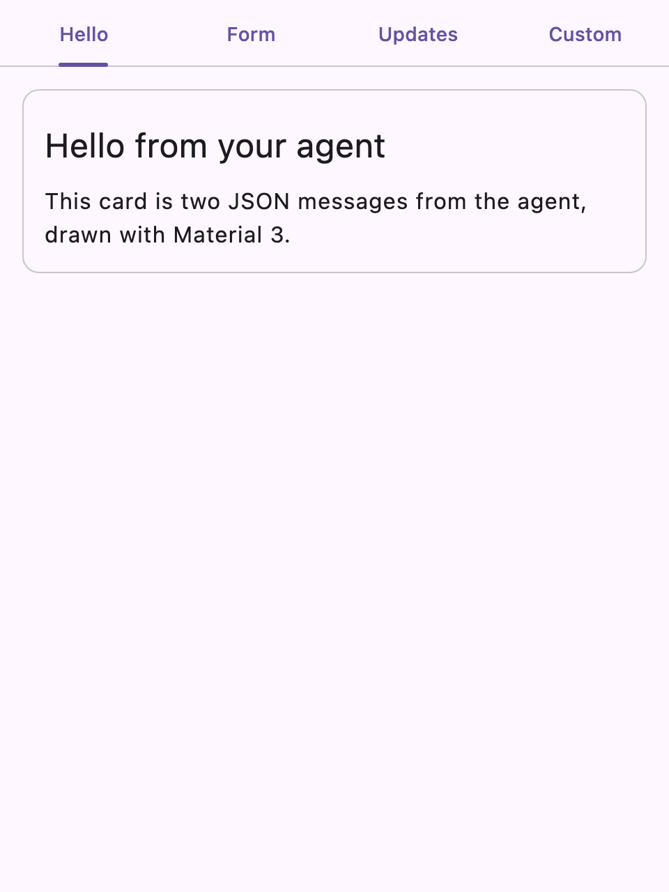
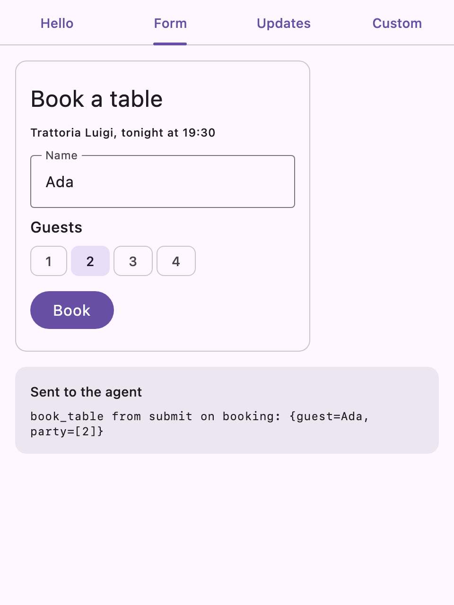
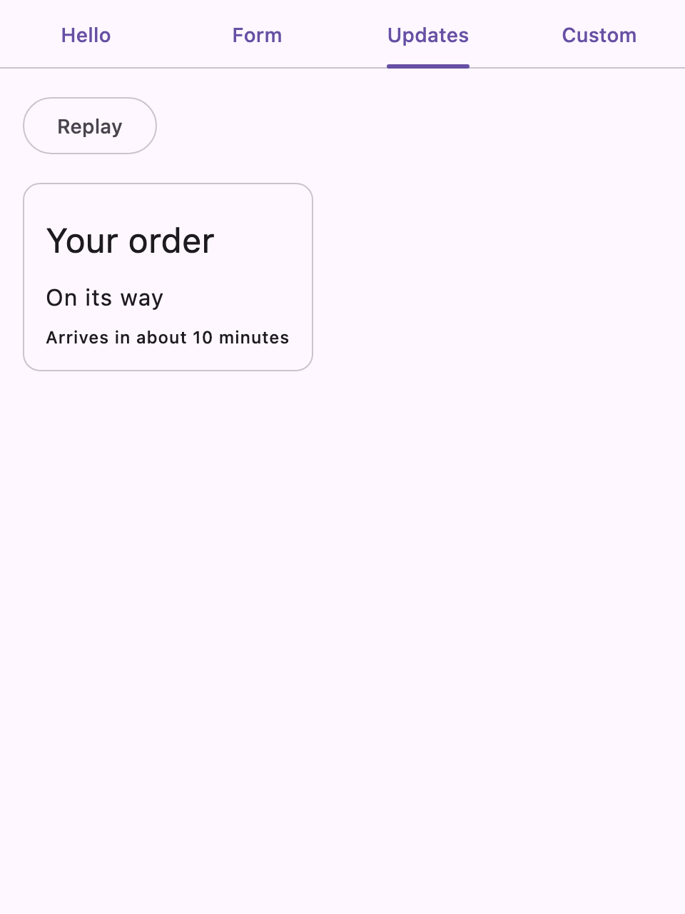
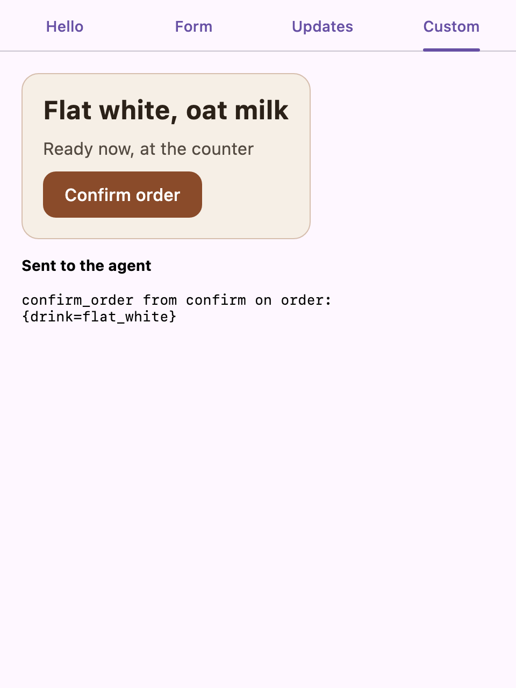

# Samples

A small Compose Multiplatform app, for desktop and iOS, that shows what an app writes to put an
agent's A2UI surfaces on screen. It is a separate project that depends on a2ui-kmp only through
its published artifacts, the way your app would.

| Tab | Package | What it shows |
| --- | --- | --- |
| Hello | `sample.material3` | The agent's JSON messages shown with the basic catalog drawn with Material 3 |
| Form | `sample.material3` | What the user does, sent back to the agent |
| Updates | `sample.material3` | The agent updating the surface's data and components over time |
| Custom | `sample.custom` | The app's own components instead of Material 3: a catalog of four, with data bindings and an action |

What the agent sends is in each package's `AgentMessages.kt`, as JSON. In an app these messages
arrive from your agent (SSE, a WebSocket, ...); everything the user does comes out of the message
processor's `outboundEvents`, for you to send to your agent. The samples list those events on
screen.

`sample.material3`: `A2ui.kt` is the setup every screen needs (the catalog and the message
processor), then one file per tab. `sample.custom`: `MyCatalog.kt` defines the components
(`Panel`, `Heading`, `Note`, `Action`) and what the agent may set on them.

The app uses `material3-a2ui`, so it needs Kotlin 2.4 and Compose Multiplatform 1.13.0-beta01. An
app with only its own components needs only `compose-ui`, with Kotlin 2.3 and Compose Multiplatform
1.12 (see the README's "Requirements").

| Hello | Form, after pressing Book | Updates, a few seconds later | Custom, after pressing Confirm order | iOS, Form, after pressing Book |
| --- | --- | --- | --- | --- |
|  |  |  |  |  |

## Running it

On its own, the sample uses the released artifacts from Maven Central:

```sh
cd samples
./gradlew :composeApp:run     # desktop
open iosApp/iosApp.xcodeproj  # iOS: run the iosApp scheme on a simulator (launch argument -tab Form opens that tab)
```

Opening the repository root in the IDE builds the sample against the source instead (the root is a
composite build). To run it on its own against a local build of a2ui-kmp, publish that build first
and point the sample at the local repository it publishes to:

```sh
./gradlew -p target/a2ui-kmp publishAllPublicationsToLocalRepository
./gradlew -p target/material3-a2ui-kmp publishAllPublicationsToLocalRepository
export ORG_GRADLE_PROJECT_a2uiRepo="$PWD/build/repo"   # the sample reads it as -Pa2uiRepo

cd samples
./gradlew :composeApp:run     # desktop
open iosApp/iosApp.xcodeproj  # iOS: run the iosApp scheme on a simulator (launch argument -tab Form opens that tab)
```

`./gradlew :composeApp:desktopTest` runs each tab as a user would (buttons, the agent's updates) and
writes the desktop screenshots above to `composeApp/build/screenshots/`. On iOS, the iosApp scheme's
UI test (`iosAppUITests`) presses Book on the Form tab in a simulator and checks the event for the
agent; with `TEST_RUNNER_A2UI_SCREENSHOT_DIR=<dir>` it also writes the screenshot above there.
